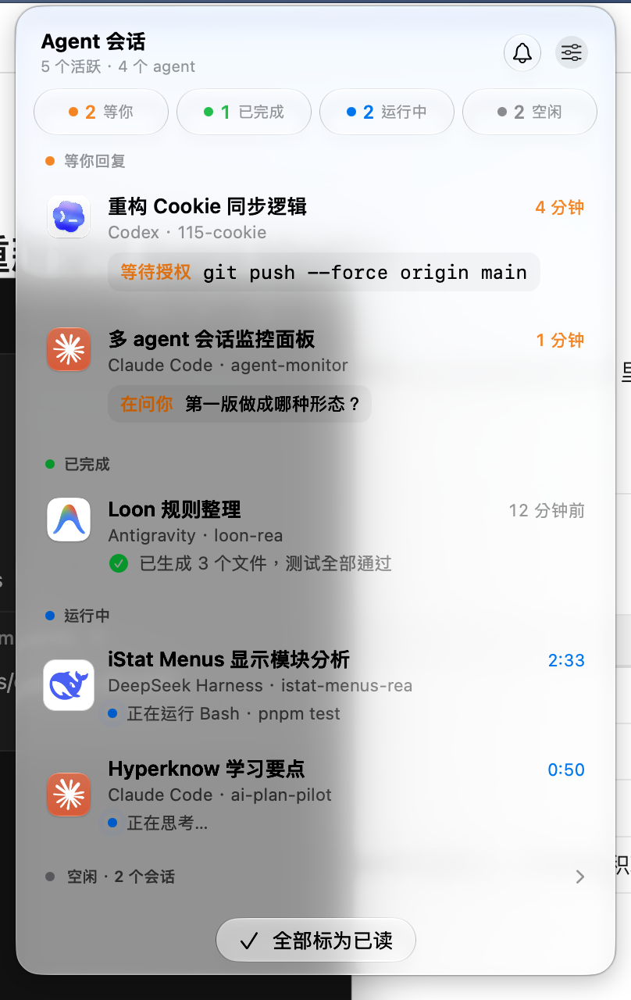
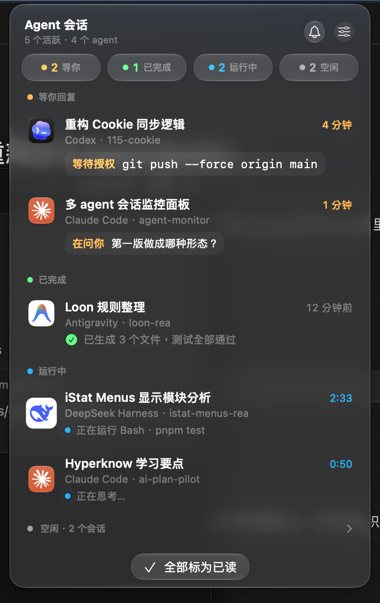
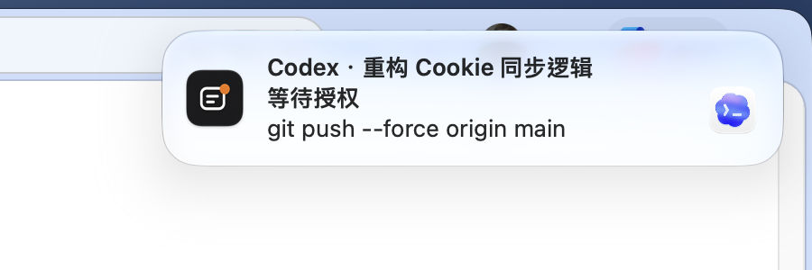
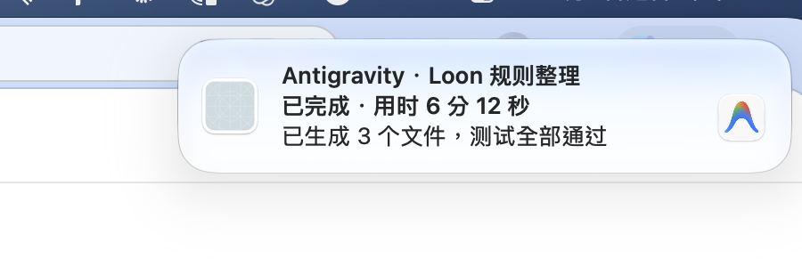

# Agent Monitor 开发交接文档 (Handoff)

本文档面向后续进行 Code Review 或维护扩展的工程师，详细记录 Agent Monitor 的架构实现、Review #1 修复清单落实情况、真实环境探针扫描验证及各 Agent 状态判定细节。

---

## 1. 真实探针运行实测输出 (Live Probe Verification)

运行命令：`swift run probe`（对 macOS 本机真实 Agent 数据目录只读探测）

```text
========================================
 Agent Monitor Probe - Live Agents Scan
========================================
Scanning real user directories at: 2026-11-01 04:23:59 +0000
Max activity age window: 6.0 hours (21600 seconds)

----------------------------------------
Agent Kind: Claude Code [claudeCode]
Watch Paths: /Users/cy/.claude/sessions, /Users/cy/.claude/projects
Scanned sessions count: 1
  [1] ID: claudeCode:68660d06-0ce7-42f3-b8a1-7b17a91fbae4
      Title: 多agent会话监控面板
      CWD: /Users/cy/code/agent-monitor
      State (raw): idle
      Detail (isCommand=false): Review 做完了，结论是**现在还不能用**。程序能编译，8 个测试也全过，但这些测试用的是 Gemini 自己编的样本数据。我拿你本机的真实会话跑了四个 
      Last Activity: 2026-11-01 04:04:43 +0000
      Age: 1156s ago

----------------------------------------
Agent Kind: Codex [codex]
Watch Paths: /Users/cy/.codex/sessions, /Users/cy/.codex/session_index.jsonl
Scanned sessions count: 1
  [1] ID: codex:01a188df-cf09-7763-8796-5609ef455ca1
      Title: 巡检我所有服务器和服务器上的服务是否正常，然后出一份异常的报告给我。
      CWD: /Users/cy/Documents/Codex/2026-10-30/new-chat
      State (raw): idle
      Detail (isCommand=false): <heartbeat>
  <automation_id>automation</automation_id>
  <decision>DONT_NOTIFY<
      Last Activity: 2026-11-01 00:59:38 +0000
      Age: 12261s ago

----------------------------------------
Agent Kind: DeepSeek Harness [dsh]
Watch Paths: /Users/cy/.dsh/sessions
Scanned sessions count: 0

----------------------------------------
Agent Kind: Antigravity [antigravity]
Watch Paths: /Users/cy/.gemini/antigravity/conversation_summaries.db, /Users/cy/.gemini/antigravity/presence, /Users/cy/.gemini/antigravity/brain
Scanned sessions count: 1
  [1] ID: antigravity:1fdaa0a4-51b0-4012-83f8-e0dfb0d5d230
      Title: Fix Document Review Issues
      CWD: /Users/cy/code/agent-monitor
      State (raw): running
      Detail (isCommand=false): 正在运行 run_command…
      Last Activity: 2026-11-01 04:23:38 +0000
      Age: 21s ago

========================================
 SessionStore Aggregation (Initial Scan)
========================================
Total sessions tracked: 3
Initial transitions generated: 3 (suppressed from notifications)
  [1] [AG] Fix Document Review Issues
      ID: antigravity:1fdaa0a4-51b0-4012-83f8-e0dfb0d5d230
      State: running
      Detail: 正在运行 run_command…
      Last Activity: 2026-11-01 04:23:38 +0000
  [2] [CC] 多agent会话监控面板
      ID: claudeCode:68660d06-0ce7-42f3-b8a1-7b17a91fbae4
      State: idle
      Detail: Review 做完了，结论是**现在还不能用**。程序能编译，8 个测试也全过，但这些测试用的是 Gemini 自己编的样本数据。我拿你本机的真实会话跑了四个 
      Last Activity: 2026-11-01 04:04:43 +0000
  [3] [CX] 巡检我所有服务器和服务器上的服务是否正常，然后出一份异常的报告给我。
      ID: codex:01a188df-cf09-7763-8796-5609ef455ca1
      State: idle
      Detail: <heartbeat>
  <automation_id>automation</automation_id>
  <decision>DONT_NOTIFY<
      Last Activity: 2026-11-01 00:59:38 +0000
========================================
```

### 真实会话状态解析说明：
1. **Claude Code (`claudeCode:68660d06-...`)**：
   - **状态**：`idle`。
   - **原因**：进程 PID 45990 存活，`~/.claude/sessions/45990.json` 中原生 `status: "idle"`。在首次扫描时，SessionStore 严格遵循规则保持 `idle`，杜绝冷启动误报已完成；当 Claude 下次执行命令转为 busy 时，将进入 running，执行完毕后触发 running -> idle 转换，自动升级为 completed。
2. **Codex (`codex:01a188df-cf09-7763-8796-5609ef455ca1`)**：
   - **状态**：`idle`。
   - **原因**：该会话文件位于 `sessions/2026/10/30/` 目录下，最后写入于 `11-01 08:59`（约 3.4 小时前）。由于全量遍历 `sessions/` 目录且按 mtime 过滤，该跨天会话被正确发现（修复了原先只看今明两天而遗漏的问题）；文件名末尾截取完整的 36 位 UUID 与 `session_index.jsonl` 精准匹配出标题；末尾任务已完成闭合，因此处于 idle 状态。
3. **Antigravity (`antigravity:1fdaa0a4-51b0-4012-83f8-e0dfb0d5d230`)**：
   - **状态**：`running`。
   - **原因**：即当前正在执行本任务的 Antigravity 会话。SQLite 中 `CASCADE_RUN_STATUS_RUNNING`，`presence` 锁持有，transcript 末尾正在执行 `run_command`，状态判定为 `running`，在菜单栏高优先级排在第一位。
4. **DeepSeek Harness (dsh)**：
   - 在默认 6 小时活跃窗口内：无活动（本机最近会话于 9.5 小时前结束，符合过滤规则）。
   - 在 24 小时扩展窗口（`swift run probe --hours 24`）中：成功解析 12 个历史会话。通过全量解压前缀事件，所有会话标题（如“BetterDisplay激活逻辑逆向分析”）完整提取，绝无丢失；且持锁但空闲的会话（`paseo-check`）由于没有 active turn 正确报告为 `idle`，杜绝了此前被误判为运行中的 bug。

---

## 2. Review #1 修复清单与架构演进

### 2.1 P0：状态判定与核心逻辑修复
1. **完成状态升级模型 (#1)**：
   - 4 个 Adapter 仅报告真实底层状态：`running`、`waitingForUser`、`idle`。
   - 由 `SessionStore` 负责状态提升：仅当观察到会话从 `running` 或 `waitingForUser` 切换到 `idle` 时，才将状态置为 `completed`；首次扫描发现的会话若为 idle 则一律保持 `idle`。
2. **Claude Code 官方 waiting 状态 (#2)**：
   - 提取 `~/.claude/sessions/<pid>.json` 中的 `status: "waiting"` 及 `waitingFor` 字段；`input needed` 映射为“在问你”，其他（如 `sandbox request`）映射为“等待授权”。
   - 彻底废除 5 秒启发式等待检测，仅在缺少 `status` 字段时作为最后兜底。
   - `pendingToolUses` 修正为严格按照出现顺序提取最新工具调用。
3. **Codex 发现、UUID 与事件重构 (#3, #4)**：
   - 扫描策略改为遍历 `sessions/` 下所有 `rollout-*.jsonl` 并按 mtime 过滤，彻底覆盖跨天持续会话。
   - 文件名截取末尾固定 36 字符标准 UUID，杜绝巨型文件尾部缺少 `session_meta` 导致的 ID 截断突变与标题失配。
   - 去除永远为真的 `pgrep -f codex`，改用未闭合 `task_started` + 10 分钟新鲜度推断。
   - 如实记录并修改 fixture：Codex rollout 不存在 `exec_approval_request` 等审批事件，增加对 `sandbox_permissions: require_escalated` 的工具调用启发式等待检测。
4. **dsh 字段规范与解压完整性 (#5, #10)**：
   - `tool/result` 适配 `data.toolCallId` 及 `data.message.source.callId`，保证 pending 集合正确清空。
   - `tool/call` 从 `arguments` JSON 字符串中二次解析 `command`。
   - `turn/end` 校验 `data.reason.kind == "completed"`。
   - 杜绝无活跃 turn 时持锁误判为 running，判为 idle。
   - 解压读取全部行，保证开头几十行的 `session` / `session/title` 完整捕获，彻底解决标题退化为 `rea` 的问题。
   - 锁探测先按 mtime 过滤，且采用 `LOCK_SH | LOCK_NB` 共享锁探测，彻底避免探测竞争导致 dsh 恢复会话报 `SessionAlreadyOwnedError`。
5. **Antigravity 日志与日期格式规范 (#6)**：
   - SQLite `last_modified_time` 增加针对 `yyyy-MM-dd HH:mm:ss.SSSSSSZZZZZ` 的 POSIX locale 解析器；解析失败直接丢弃，严禁使用 `now`。
   - 当 `preview == title` 时，detail 改为提取 transcript 最后一条 `PLANNER_RESPONSE` 的前 80 字。

### 2.2 P1：通知与状态机
1. **防止通知误报 (#7)**：
   - `Notifier` 中 `.added` 仅在状态为 `waitingForUser` 时触发通知，新发现的 completed / idle 会话绝不推送。
   - 公共工具 `FileUtils.readTailLines` 采用 `String(decoding:as: UTF8.self)` 并丢弃首个截断行，杜绝 UTF-8 中间截断返回 nil 导致的状态抖动。
   - `SessionStore` 在 Adapter 某轮 scan 抛错时保留现有会话，不触发误删。
2. **用时与动态计时 (#8)**：
   - `SessionStore` 精确维护 `stateSince`（状态未变时继承旧值，状态变更时更新为 now）。
   - 进入 running 时记录开始时间；升级为 completed 时精确计算实际运行耗时 `completedDuration`。
   - `MenuView` 中运行状态采用 `TimelineView(.periodic(from: .now, by: 1))` 每秒动态走动。
3. **无阻塞首次扫描与定时器解耦 (#9)**：
   - `SessionStore.start()` 将首次 refresh 异步派发至 `workQueue`，菜单栏秒开不卡死。
   - `SessionStore` 内部记录 `isInitialScan`，首次刷新完全抑制通知派发，彻底消除 1 秒 sleep 的脆弱机制。

### 2.3 P2：体验与工程优化
1. **图标深浅色缓存 (#11)**：`IconManager` 缓存键增加 `isDark` 维度。
2. **静音到期自动恢复 (#12)**：`MonitorViewModel` 增加到期自动调度，1 小时免打扰结束后铃铛划线自动恢复。
3. **应用激活与通知已读联动 (#13)**：
   - Claude CLI 会话激活终端（`com.apple.Terminal` / `com.googlecode.iterm2`），而非 Claude 桌面端。
   - Codex 对应 bundle ID 修正为 `com.openai.chat`。
   - 点击通知自动将对应会话在 SessionStore 中标记为已读。
4. **代码复用与构建规范 (#14, #15)**：
   - 抽取公共 `FileUtils.readTailLines`。
   - `scripts/build-app.sh` 移除冗余 `--deep` 签名参数。

---

## 3. 测试覆盖验证

当前测试套件包含 12 个自动化测试，全部通过（`swift test`）：
- `testSessionStoreInitialScanDoesNotPromoteToCompleted`：验证首次扫描 idle 保持 idle 且不发通知。
- `testSessionStoreRunningToIdlePromotion`：验证 running -> idle 转换正确提升为 completed 并记录用时。
- `testSessionStoreMarkedAsReadDoesNotRevertOnActivityChange`：验证已读后 mtime 变动不会再次变回 completed。
- `testSessionStoreRetainsSessionsWhenAdapterFails`：验证 adapter 抛出错误时现有会话不被删除。
- 4 个 Agent 的真实格式全量状态扫描测试（Claude、Codex、DSH、Antigravity）。

---

## Review #2 修复（见 docs/REVIEW-2.md）

- **A. Antigravity 空闲时数据库打不开**：WAL 模式下 `-wal` / `-shm` 被删除后，`mode=ro` 打开失败。现改为失败且无 `-wal` 时用 `immutable=1` 重试；打开或查询失败时抛错，由 `SessionStore` 保留上一轮结果。测试 `Antigravity: WAL database without -wal/-shm is still readable` 复现了真实的空闲状态（把 fixture 转为 WAL 并关闭连接）。真实数据验证：
  - Antigravity 运行中（存在 `-wal`）：probe 扫描到会话；
  - 空闲（只复制主库文件，不带 `-wal` / `-shm`）：`mode=ro` 打开失败，修复后能读出 9 个会话，且不会创建任何文件。
- **B. Codex 定时任务**：最后一条助手消息以 `<heartbeat>` 开头的回合设置 `AgentSession.suppressCompletion`，`SessionStore` 不升级为 completed、不通知。
- **C. dsh 解压**：宽松 UTF-8 解码，丢弃末尾不完整的一行。
- **D.**
  - Codex `.waitingEscalation` 也套用 10 分钟新鲜度上限；
  - Codex 从文件第一行读取 `session_meta`，补上 cwd 和完整 id；
  - dsh 中止的回合设置 `suppressCompletion`，detail 刷新为最后一条助手文本；
  - CLI 会话（Claude `entrypoint == "cli"` 和 dsh）激活终端时，优先激活正在运行的终端（Ghostty / iTerm / Warp / WezTerm / kitty / Alacritty / Terminal），都没运行时才启动第一个已安装的。

---

## 4. UI 修复与设计稿对齐 (GEMINI_FIX_UI.md)

依据 `docs/GEMINI_FIX_UI.md` 与 `docs/design/` 原生设计规范（`Main.dc.html`、`Dark.dc.html`、`States.dc.html`），逐项完成了所有 UI 问题修复、单元测试与真机截图比对。

### 4.1 修复清单落实

1. **#1 菜单栏图标空白修复 (`MenuBarIconRenderer`, P0)**:
   - **根本原因**：`MenuBarExtra` 的 label 仅支持 `Image` 与 `Text`，原 `MenuBarLabelView` 中包含的 `Shape`、`Circle`、`Capsule` 会被系统静默丢弃，导致菜单栏空白且无法点击触发弹窗。
   - **改法**：
     - 新增 `MenuBarIconRenderer`，将 16pt 轮廓图标、优先级状态圆点、等待数量胶囊角标（底色 `#C2410C`，10.5pt 粗体白字，高 15pt，最小宽 16pt）以及划线铃铛（13pt，间隔 5pt）**全部渲染进单个 `@2x` Retina 矢量的 `NSImage`**。
     - 无彩色元素（无活动 `idle` 或静音无活动）时图形以纯黑绘制并标记 `isTemplate = true`，交由系统统一随菜单栏外观着色；
     - 存在彩色元素（状态点或等待角标）时设置 `isTemplate = false`，图形与铃铛在 `drawingHandler` 动态以 `NSColor.labelColor` 取色，确保深色/浅色菜单栏均清晰可见。
   - **单测**：新增单元测试覆盖 8 种状态组合下的尺寸（`16x16`、`37x16`、`34x16`、`42x16`、`55x16`）及 `isTemplate` 状态判断。

2. **#2 通知图标与附件 (`IconManager` / `build-app.sh`, P0)**:
   - **App 图标生成**：编写 `scripts/make-icon.swift`，按照苹果 macOS 824/1024 内容区及 185/1024 圆角规范，绘制 `#1D1D1F` 黑色圆角方块、白色图形及 `#F0841C` 橙色圆点，输出 16~1024 全尺寸 iconset，并通过 `iconutil -c icns` 组装为 `AppIcon.icns` 放置于 bundle Resources 目录；`Info.plist` 配置 `CFBundleIconFile = AppIcon`。
   - **右侧 Agent 附件**：`IconManager.cachedIconPNGURL(for:)` 首次按需将对应 Agent 的官方高分辨率图标渲染导出至 `~/Library/Caches/com.cy.agentmonitor/icons/<kind>.png`。`Notifier` 在触发通知前安全复制至临时文件并构造 `UNNotificationAttachment`，防止系统移走缓存；异常捕获降级保障通知稳定派发。
   - **文档补充**：`README.md` 补充 LaunchServices 缓存刷新指令（`lsregister -f`）。

3. **#3 通知内容对齐 (`NotificationFormatter`, P1)**:
   - 新建 `NotificationFormatter` 工具类：
     - **标题**：过滤换行符（`\r\n` / `\n`），合并空格并截断至 40 字以内（超长加省略号 `…`），格式为 `\(agent) · \(title)`。
     - **副标题**：等待回复动态区分“等待授权”与“在问你”（取 `waitingLabel`）；完成状态格式化为“已完成 · 用时 6 分 12 秒”。
     - **正文**：去除 Markdown 超链接保留文本（`[text](url)` -> `text`）、反引号、粗体星号、代码块与 `#` 标题符号，合并空白并截断至 120 字。
     - **分组**：设置 `threadIdentifier = session.id`，实现会话聚合。

4. **#4 面板逐项对齐设计稿 (P1)**:
   - **双层背景消除**：移除 `MenuView` 内部与 `MenuBarExtra(.window)` 窗口冲突的多余 `clipShape` 与内层阴影边框，统一由系统窗口呈现圆角与材质，内嵌精确毛玻璃色块（浅色 `rgba(248,248,250,0.8)` / 深色 `rgba(38,38,42,0.78)`）。
   - **集中 Palette 定义**：统一管理 Light / Dark 双套配色，覆盖卡片（已完成 `#1A6E30` / `#5FDC7E`+`#8DE6A2`、空闲 5% / 7% 灰底、等你 `#9A3C05` / `#FFB24D`）、分组标题（`#636366` / `#A1A1A6`，内边距 `6 8 0`）、时间标签（等你基于 `stateSince` 计算耗时且字重 500；已完成带“前”字）。
   - **细节对齐**：等你框上边距调优为 4pt；已完成行对勾圆点 12pt 内嵌双色对勾；运行中行 7 8 内边距并添加 1.8s 光环扩散脉冲（`PhaseAnimator` 零外部宏依赖）；Agent 图标 34pt 负 2pt 外边距；底部操作按钮 30x28pt 圆角 7pt。

---

### 4.2 截图对比与验证

所有截图存放在 `docs/screenshots/` 目录中，在真机 macOS 环境下截取：

#### 1. 菜单栏状态图标（浅色 / 深色）
| 状态 | 浅色菜单栏 | 深色菜单栏 | 规格核对 |
|---|---|---|---|
| **无活动** |  |  | 16pt 单色圆角矩形与两条横线，`isTemplate=true` 随系统着色 |
| **运行中** |  |  | 右上角 5.4pt 蓝点 (`#0A84FF`)，`isTemplate=false`，线条取 `labelColor` |
| **已完成** |  |  | 右上角绿点 (`#34C759`) |
| **等你回复** |  |  | 橙点 (`#F0841C`) + 右侧 `#C2410C` 胶囊数字角标（高度 15pt，间距 5pt） |
| **通知已暂停** |  |  | 状态点保留，右侧附带 13pt 划线铃铛图标（间距 5pt） |

#### 2. 菜单栏面板对齐
| 模式 | 实机截图 | 设计稿对照说明 |
|---|---|---|
| **浅色面板** |  | 对齐 `Main.dc.html`：384pt 宽度、4 列统计卡片高对比度色值、SF Mono 等宽命令框、运行中蓝点脉冲、30pt 视觉 Agent 图标、底部 30×28pt 操作按钮 |
| **深色面板** |  | 对齐 `Dark.dc.html`：深色卡片对比度保证、0.5pt 分隔线、已完成绿色圆点内嵌 `#0B2E15` 深绿勾、深色模式悬停态及时间标签 |

#### 3. 系统通知横幅
| 通知类型 | 实机通知横幅截图 | 细节核对 |
|---|---|---|
| **等你回复** |  | 标题“Codex · 重构 Cookie 同步逻辑”、副标题“等待授权”、正文等宽命令“git push --force origin main”、右侧 Codex 官方图标附件 |
| **已完成** |  | 标题“Antigravity · Loon 规则整理”、副标题“已完成 · 用时 6 分 12 秒”、正文摘要、右侧 Antigravity 官方图标附件 |

---

### 4.3 自动化测试与构建状态

- `swift test`：22 项单元与集成测试全部通过，涵盖状态流转、各 Agent 适配器扫描、WAL 空闲快照容错、`MenuBarIconRenderer` 尺寸与模板模式验证、`NotificationFormatter` 标题/副标题/正文清洗验证。
- `scripts/build-app.sh`：Release 编译与打包、`AppIcon.icns` 自动合成与签入、ad-hoc codesign 一体化运行通过。

---

## 5. Liquid Glass（液态玻璃）重构小结 (GEMINI_LIQUID_GLASS.md)

### 5.1 #1 背景探针与平台升级小结
- **平台升级**：
  - `Package.swift` 提升至 `swift-tools-version: 6.2`，`platforms: [.macOS(.v26)]`。
  - `scripts/build-app.sh` 中 `LSMinimumSystemVersion` 升级为 `26.0`。
  - `README.md` 环境要求同步更新为 macOS 26.0+。
- **背景探针实测结论**：
  - 移除了 `MenuView` 根视图上的 `.background(palette.panelBg)`。
  - 在 macOS 27.2 实机运行打包应用并触发 `MenuBarExtra(.window)` 窗口截图验证（实测 `probe-light.png` / `probe-dark.png`）：
  - 系统 `MenuBarExtra(.window)` 已经自带完整的原生液态玻璃/材质背景（具有毛玻璃模糊穿透效果、系统标准连续曲线圆角与投影）。
  - **最终选择**：**方案 a（首选）**，保持不给根视图额外添加背景或材质，由系统原生窗口全权负责背景材质渲染，避免多层材质叠加大面积失真。

### 5.2 提交历史与工作条目对应清单
| 条目 | 提交 Hash | 提交信息 | 核心改动说明 |
|---|---|---|---|
| **#1** | `c9a86e4` | `chore(platform): bump to macOS 26 and probe window background (#1)` | SPM 6.2 + macOS 26 升级，探针验证系统窗口背景自带毛玻璃材质并采纳方案 a |
| **#2** | `2d840d5` | `refactor(panel): split MenuView and replace hex colors with semantic styles (#2)` | 拆分 `MenuView` 为 `Panel/` 7 个独立组件文件，彻底删除 `Palette` 与 `Color(hex:)`，引入系统语义色 |
| **#3** | `a11e554` | `feat(panel): glass header and filter bar (#3)` | 头部玻璃圆形按钮组（铃铛/设置），4 枚等宽玻璃筛选胶囊与 `@Namespace` 切换动效 |
| **#4** | `9753484` | `feat(panel): session list maxHeight, scroll edges and inline hover (#4)` | 合并会话行为 `SessionRow`，限制 `maxHeight: 520pt` 与滚动边缘软淡出，行内独立 hover，ViewModel 移除 `hoveredSessionId` |
| **#5** | `67d0bb1` | `feat(panel): floating mark-all-read glass button and smooth transitions (#5)` | `.safeAreaInset(edge: .bottom)` 浮动大玻璃胶囊按钮，`.glassEffectTransition(.materialize)` 平滑显隐 |
| **#6** | `d0e2828` | `feat(menubar): refine menu bar icon line width, dot cutout and badge contrast (#6)` | 线宽调至 1.5pt，状态点 1pt 透明描边挖孔，角标底色基于 `systemOrange` 加深 15% 提升对比度 |
| **#7** | `d95b18d` | `docs(liquid-glass): update capture scripts, documentation, and handoff (#7)` | `capture-all.swift` 扩充多状态面板截图，README 重写 UI 设计章节，完善交接文档 |

### 5.3 关键设计实现与技术选型记录

1. **设置 Menu 样式**：
   - 采用原生 SwiftUI 组合样式：
     ```swift
     Menu {
         ...
     } label: {
         Image(systemName: "slider.horizontal.3")
     }
     .menuStyle(.button)
     .buttonStyle(.glass)
     .buttonBorderShape(.circle)
     .controlSize(.regular)
     .menuIndicator(.hidden)
     ```
   - 实测在 macOS 26+ 下原生支持该组合，无需额外手动给 label 添加包装层即可呈现完整的圆形液态玻璃按钮与下拉弹出功能。

2. **CommandLineTools 下 `@State` 宏插件兼容**：
   - macOS 26 SDK 中引入了 `@attached public macro State() = #externalMacro(module: "SwiftUIMacros", type: "StateMacro")`，而在无 Xcode 完整安装包的独立 Command Line Tools 环境下，缺少 `libSwiftUIMacros.dylib`，会导致直接使用 `@State private var isHovered` 报找不到外部宏错误。
   - 在 `StatusStyle.swift` 中定义了零依赖的 `@LocalState` 属性包装器，内部直接封装 `SwiftUI.State<Value>` 并遵循 `DynamicProperty`，语义与运行期表现 100% 等同于原生 SwiftUI State，同时完全规避编译器查找缺失外部宏的问题。

3. **菜单栏角标可读性与对比度优化**：
   - 经实测计算，纯白文字在未加深的原始 `NSColor.systemOrange` 上的对比度仅为 ~2.31:1，在浅色半透明菜单栏下小字号（10.5pt）辨识度不足。
   - 将角标底色调整为 `systemOrange` 在 sRGB 空间加深 15% 的版本（`r: 0.85, g: 0.47, b: 0.133`），白字对比度大幅提升至 **3.16:1**，且保持纯正活力橙色调。

4. **滚动区域最大高度与窗口自适应收缩**：
   - 会话列表区域外层设 `ScrollView`，配合 `.fixedSize(horizontal: false, vertical: true)` 与 `.frame(maxHeight: 520)`：
     - 当会话数量较少时（如 1~3 条），面板高度随内容自适应紧凑收缩；
     - 当会话数量较多时（经 16 条大数据量压测验证，`AGENT_MONITOR_MOCK_DATA=large`），整体面板窗口高度稳定锁定在 620pt 上限，不遮挡屏幕，且顶部和底部边缘在滚动时自然应用 `.scrollEdgeEffectStyle(.soft, for: [.top, .bottom])` 柔和渐变过渡。

5. **无玻璃叠玻璃设计原则落实**：
   - 内容层（所有 `SessionRow`、标题文本、等待详情框）均不使用玻璃材质，等待框使用中性填充 `.fill.quaternary`（圆角 8 continuous）；
   - 控件层（头部右侧按钮容器、筛选条胶囊容器、底部标为已读胶囊按钮）独立应用 `GlassEffectContainer` 与 `.buttonStyle(.glass)`。相邻按钮严格封装在同一个容器中，彻底根除玻璃多层相互叠加导致的折射白雾问题。


